# Neural ODEs Near Equilibrium Points

Bachelor's thesis, Slovak University of Technology in Bratislava, Faculty of Electrical Engineering and Information Technology, 2026.
Original title: *Neurónové ODE v blízkosti rovnovážnych bodov*.

The thesis received a Dean's scholarship at STU FEI.

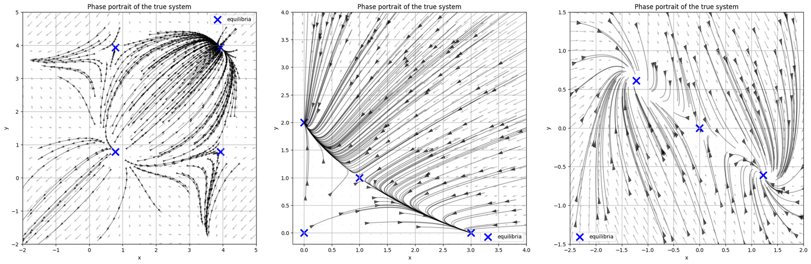

*Phase portraits of the trigonometric, Rabbit–Sheep and FitzHugh–Nagumo systems. Equilibria are marked with blue crosses.*

## Overview

A Neural ODE learns a vector field $\dot{\mathbf{x}} = f_\theta(\mathbf{x}, t)$ from observed trajectories and is trained only on trajectory error. In dynamical systems, however, the most important properties are often local: where the equilibria are, whether they are stable, and what the eigenvalues of the linearisation are.

This project trains Neural ODEs on three nonlinear two-dimensional systems and checks whether these local properties are preserved. For each trained model the equilibria are located by solving $f_\theta(\mathbf{x}^*) = 0$, the Jacobian $J_\theta(\mathbf{x}^*)$ is computed, and its eigenvalues are compared with the analytic ones.

Summary of results:

- All models reach low and matching train and test error (test MSE between $3.4 \cdot 10^{-4}$ and $4.4 \cdot 10^{-3}$).
- The learned vector fields agree with the true ones in almost the whole state space.
- The stability type is correct for 10 of 11 equilibria. For FitzHugh–Nagumo the model also recovers the complex eigenvalues of both foci and the symmetry of the system.
- In the Rabbit–Sheep system, an unstable node at the origin is learned as a saddle because there are few trajectories near it.
- When training data is removed from a neighbourhood of a stable equilibrium, trajectories outside that neighbourhood remain accurate, but the eigenvalues at the equilibrium degrade and the stability type can change.

Low trajectory error therefore does not imply that the local dynamics have been learned correctly.

## Contents

1. [Method](#method)
2. [Background](#background)
3. [Studied systems](#studied-systems)
4. [Implementation](#implementation)
5. [Results](#results)
6. [Conclusions](#conclusions)
7. [Repository structure](#repository-structure)
8. [Running the code](#running-the-code)
9. [Author and citation](#author-and-citation)

## Method

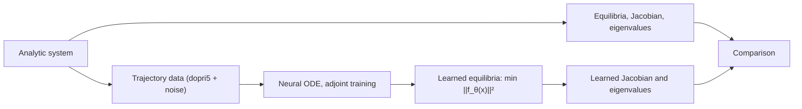

## Background

**From ResNet to Neural ODE.** A residual block $h_{k+1} = h_k + f(h_k, \theta_k)$ is one explicit Euler step. In the limit of many small steps the hidden state follows an ODE whose right-hand side is a neural network ([Chen et al., 2018](https://arxiv.org/abs/1806.07366)):

$$\frac{d\mathbf{h}(t)}{dt} = f(\mathbf{h}(t), t, \theta)$$

**Adjoint method.** Gradients are obtained by solving the adjoint equation backwards in time instead of storing every solver step:

$$\frac{d\mathbf{a}(t)}{dt} = -\mathbf{a}(t)^\top \frac{\partial f}{\partial \mathbf{h}}, \qquad \mathbf{a}(t_1) = \frac{\partial L}{\partial \mathbf{h}(t_1)}, \qquad \frac{\partial L}{\partial \theta} = -\int_{t_1}^{t_0} \mathbf{a}(t)^\top \frac{\partial f}{\partial \theta}\, dt$$

Memory cost no longer grows with the number of solver steps, but training takes longer. Comparison on a damped pendulum:

| Method | Training time (s) | GPU memory (MB) | MSE |
|---|---:|---:|---:|
| Backpropagation | 33.4 | 214.8 | 1.805 |
| Adjoint method | 287.6 | 24.7 | 1.629 |

**Stability.** Near an equilibrium $\mathbf{x}^*$ the system is approximated by $\dot{\mathbf{z}} = J(\mathbf{x}^*)\mathbf{z}$, and the eigenvalues of $J$ determine the type of the equilibrium.

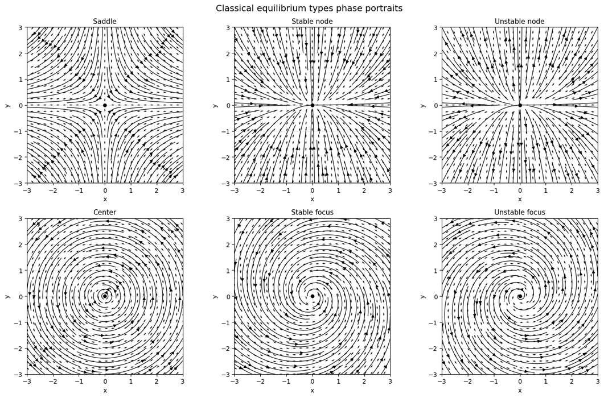

| Eigenvalues | Type |
|---|---|
| $\lambda_1, \lambda_2 < 0$ | stable node |
| $\lambda_1, \lambda_2 > 0$ | unstable node |
| $\lambda_1 < 0 < \lambda_2$ | saddle |
| $\alpha \pm i\beta,\ \alpha < 0$ | stable focus |
| $\alpha \pm i\beta,\ \alpha > 0$ | unstable focus |
| $\pm i\beta$ | center |

## Studied systems

### Trigonometric system

$$\dot x = -2(\cos x - \sin x) - (\cos y - \sin y), \qquad \dot y = -2(\cos y - \sin y) - (\cos x - \sin x)$$

Equilibria lie at $(\tfrac{\pi}{4}+k\pi,\ \tfrac{\pi}{4}+l\pi)$. Four of them lie in the domain $[0, 4.5]^2$.

| Equilibrium | Eigenvalues | Type |
|---|---|---|
| E1 $(\tfrac{\pi}{4},\tfrac{\pi}{4})$ | $3\sqrt2,\ \sqrt2$ | unstable node |
| E2 $(\tfrac{\pi}{4},\tfrac{5\pi}{4})$ | $\pm\sqrt6$ | saddle |
| E3 $(\tfrac{5\pi}{4},\tfrac{\pi}{4})$ | $\pm\sqrt6$ | saddle |
| E4 $(\tfrac{5\pi}{4},\tfrac{5\pi}{4})$ | $-3\sqrt2,\ -\sqrt2$ | stable node |

### Rabbit–Sheep competition model

$$\dot x = 3x - x^2 - 2xy, \qquad \dot y = 2y - xy - y^2$$

| Equilibrium | Eigenvalues | Type |
|---|---|---|
| E1 $(0,0)$ | $3,\ 2$ | unstable node |
| E2 $(3,0)$ | $-3,\ -1$ | stable node |
| E3 $(0,2)$ | $-1,\ -2$ | stable node |
| E4 $(1,1)$ | $-1 \pm \sqrt2$ | saddle |

### FitzHugh–Nagumo model

With parameters $a = 0,\ b = 2,\ c = 1,\ z = 0$:

$$\dot x_1 = x_2 + x_1 - \frac{x_1^3}{3}, \qquad \dot x_2 = -(x_1 + 2x_2)$$

| Equilibrium | Eigenvalues | Type |
|---|---|---|
| E1 $(0,0)$ | $\tfrac{-1\pm\sqrt5}{2}$ | saddle |
| E2 $(\sqrt{3/2},\ -\tfrac12\sqrt{3/2})$ | $-\tfrac54 \pm i\tfrac{\sqrt7}{4}$ | stable focus |
| E3 $(-\sqrt{3/2},\ \tfrac12\sqrt{3/2})$ | $-\tfrac54 \pm i\tfrac{\sqrt7}{4}$ | stable focus |

## Implementation

The vector field is modelled by the same time-dependent MLP for all systems:

```
input (x, y, t) -> Linear(3, 64) -> Tanh -> Linear(64, 64) -> Tanh -> Linear(64, 2)
```

Weights use Xavier uniform initialisation and biases start at zero. Training uses `torchdiffeq.odeint_adjoint` with the Dormand–Prince solver (`dopri5`, `rtol=1e-3`, `atol=1e-4`), the Adam optimiser, MSE loss over whole trajectories, and gradient clipping at norm 5.0.

The training set contains 900 trajectories started from a regular 30 × 30 grid. The test set contains 600 trajectories started from random initial conditions. Each trajectory has 100 time points and Gaussian noise with amplitude 0.01.

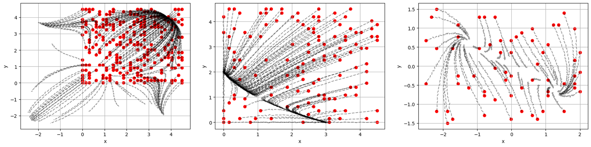

*Training trajectories with initial conditions in red: trigonometric, Rabbit–Sheep, FitzHugh–Nagumo.*

| | Trigonometric | Rabbit–Sheep | FitzHugh–Nagumo |
|---|---|---|---|
| Domain | $[0, 4.5]^2$ | $[0, 4.5]^2$ | $[-2.5, 2] \times [-1.5, 1.5]$ |
| Time interval | $[0, 1]$ | $[0, 3]$ | $[0, 1]$ |
| Batch size | 256 | 128 | 64 |
| Epochs | 800 | 900 | 700 |
| Learning rate | $10^{-3}$ | $10^{-3}$ | $10^{-4}$ |

Learned equilibria are found by minimising $\lVert f_\theta(\mathbf{x}) \rVert^2$ starting near each analytic equilibrium. The Jacobian is then computed with autograd. In the FitzHugh–Nagumo system the two foci are close to each other, and a single start often converged to the wrong one. The search therefore uses several starts per equilibrium and keeps the candidate closest to the analytic point that also has a small residual.

## Results

### Training and test error

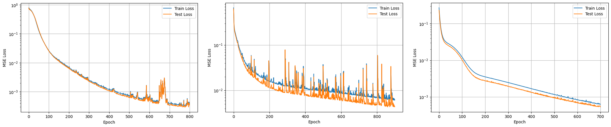

| System | Train MSE | Test MSE |
|---|---:|---:|
| Trigonometric | 0.000379 | 0.000344 |
| Rabbit–Sheep | 0.00627 | 0.00440 |
| FitzHugh–Nagumo | 0.000630 | 0.000536 |

Train and test error stay close throughout training, so there is no sign of overfitting. The Rabbit–Sheep loss oscillates the most. A likely reason is the sensitivity of its Jacobian. Moving from $(1,1)$ to $(1.1,1)$ changes all four entries of $J$, whereas in FitzHugh–Nagumo the same shift changes only one entry.

### Position of equilibria

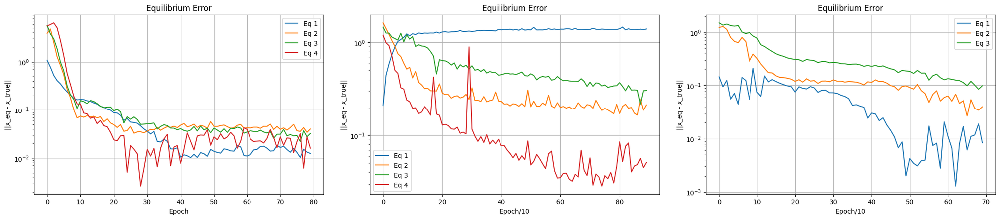

| System | Point | Learned | True | Error |
|---|---|---|---|---:|
| Trigonometric | E1 | (0.773, 0.795) | (0.785, 0.785) | 0.015 |
| | E2 | (0.797, 3.896) | (0.785, 3.927) | 0.033 |
| | E3 | (3.933, 0.815) | (3.927, 0.785) | 0.030 |
| | E4 | (3.939, 3.955) | (3.927, 3.927) | 0.030 |
| Rabbit–Sheep | E1 | (1.024, 0.947) | (0, 0) | 1.395 |
| | E2 | (2.796, −0.061) | (3, 0) | 0.213 |
| | E3 | (0.232, 1.803) | (0, 2) | 0.305 |
| | E4 | (0.949, 0.997) | (1, 1) | 0.051 |
| FitzHugh–Nagumo | E1 | (0.007, −0.005) | (0, 0) | 0.008 |
| | E2 | (1.196, −0.585) | (1.225, −0.612) | 0.040 |
| | E3 | (−1.143, 0.556) | (−1.225, 0.612) | 0.099 |

The large error at the Rabbit–Sheep origin comes from the data. For initial conditions with negative coordinates, the quadratic terms grow quickly; for example, $\dot x = -330$ at $(-10,-10)$. The solver failed there, so few informative trajectories pass near the origin or along the axes.

### Eigenvalues and stability type

**Trigonometric system:** all four types correct.

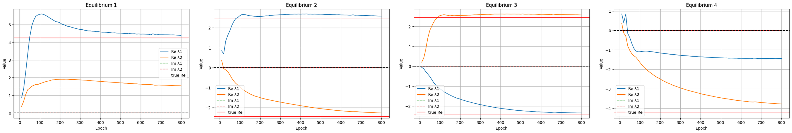

| Point | Analytic | Learned | Type |
|---|---|---|---|
| E1 | 1.414; 4.243 | 1.538; 4.391 | unstable node, correct |
| E2 | 2.449; −2.449 | 2.589; −2.269 | saddle, correct |
| E3 | −2.449; 2.449 | −2.346; 2.577 | saddle, correct |
| E4 | −4.243; −1.414 | −3.780; −1.444 | stable node, correct |

**Rabbit–Sheep:** three of four types correct.

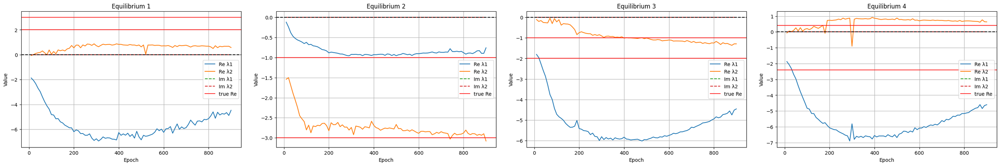

| Point | Analytic | Learned | Analytic type | Learned type |
|---|---|---|---|---|
| E1 | 3; 2 | 0.577; −4.474 | unstable node | saddle |
| E2 | −3; −1 | −3.080; −0.758 | stable node | stable node |
| E3 | −1; −2 | −1.289; −4.459 | stable node | stable node |
| E4 | 0.414; −2.414 | 0.635; −4.604 | saddle | saddle |

At E3 and E4 one eigenvalue is close to the analytic value while the other is clearly off. Both points lie in a region where trajectories from competing attractors meet and the direction of the flow changes quickly.

**FitzHugh–Nagumo:** all three types correct, including the oscillatory character of the foci.

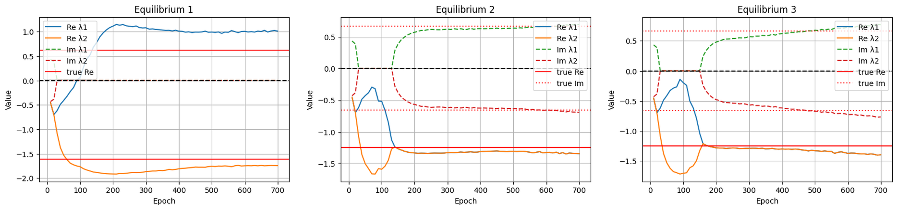

| Point | Analytic | Learned | Type |
|---|---|---|---|
| E1 | 0.618; −1.618 | 1.011; −1.746 | saddle, correct |
| E2 | −1.250 ± 0.661i | −1.344 ± 0.693i | stable focus, correct |
| E3 | −1.250 ± 0.661i | −1.396 ± 0.767i | stable focus, correct |

The model converges to almost identical complex pairs at E2 and E3. It therefore reproduces the symmetry of the system, even though the symmetry was not part of training.

Across all three systems, stable nodes and foci are approximated more accurately than saddles. A saddle has both an attracting and a repelling direction, and small errors in the vector field near it have a larger effect.

### Vector fields

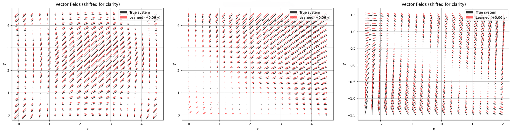

*True field in black, learned field in red (shifted by 0.06 in y for readability).*

The learned fields agree with the true fields in direction and magnitude almost everywhere. The main deviations are near the Rabbit–Sheep origin, where the model overestimates the speed, and at the edges of the domains.

### Removing data near a stable equilibrium

For this experiment, all trajectory data inside a disc of radius $r$ around a stable equilibrium was removed. A separate model was then trained for each $r \in \{0, 0.5, 1, 2, 4\}$. The experiment shows how well the model reconstructs local dynamics in a region it has no data from.

**Trigonometric system, stable node at $(5\pi/4, 5\pi/4)$**

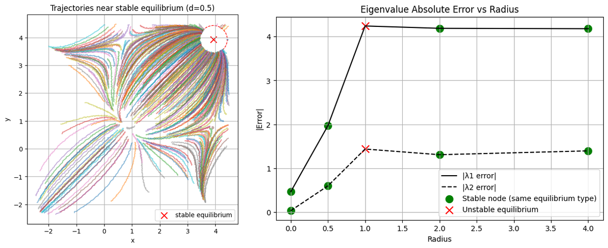

| r | True | Learned |
|---|---|---|
| 0 | (−4.243; −1.414) | (−3.780; −1.444) |
| 0.5 | (−4.243; −1.414) | (−2.273; −0.818) |
| 1 | (−4.243; −1.414) | (0.000; 0.022), classified as unstable |
| 2 | (−4.243; −1.414) | (−0.054; −0.108) |
| 4 | (−4.243; −1.414) | (−0.062; −0.020) |

**Rabbit–Sheep, stable node at $(3, 0)$**

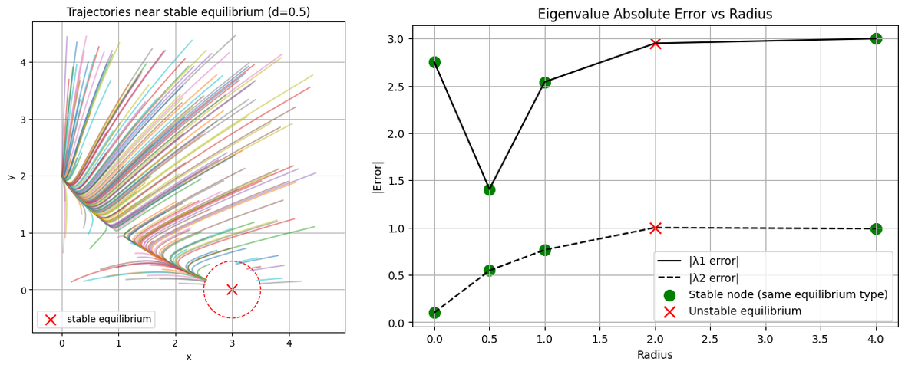

| r | True | Learned |
|---|---|---|
| 0 | (−3; −1) | (−1.102; −5.749) |
| 0.5 | (−3; −1) | (−0.453; −4.407) |
| 1 | (−3; −1) | (−0.459; −0.235) |
| 2 | (−3; −1) | (−0.051; 0.000), classified as unstable |
| 4 | (−3; −1) | (−0.0004; −0.012) |

**FitzHugh–Nagumo, stable focus**

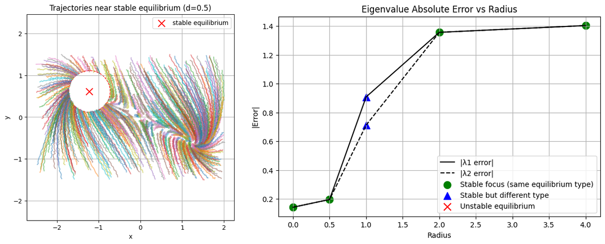

| r | True | Learned |
|---|---|---|
| 0 | −1.25 ± 0.661i | −1.374 ± 0.730i |
| 0.5 | −1.25 ± 0.661i | −1.440 ± 0.706i |
| 1 | −1.25 ± 0.661i | −0.628; −1.514, stable node instead of focus |
| 2 | −1.25 ± 0.661i | −0.039 ± 0.050i |
| 4 | −1.25 ± 0.661i | −0.007 ± 0.009i |

For small radii the model still reproduces the local behaviour reasonably well. For larger radii the eigenvalues shrink towards zero, which means the model learns an almost stationary region instead of a strong attractor. In each system there is a radius at which the type of the equilibrium changes: from stable to unstable, or from a focus to a node. Meanwhile the trajectories outside the removed region remain well approximated, so this failure cannot be detected from trajectory error.

## Conclusions

1. Trajectory error is a global measure, while eigenvalues depend on the derivatives of the learned field. A small error in $\partial f_\theta / \partial \mathbf{x}$ can change the stability of an equilibrium even when trajectories fit well.
2. Accurate local dynamics require data near the equilibrium. Without it the Jacobian there is weakly constrained.
3. Saddles were harder to approximate than nodes and foci.
4. Neighbouring equilibria with different stability make both training and equilibrium search harder.
5. The model can recover structure that was not given explicitly, such as the symmetry of the FitzHugh–Nagumo system and the oscillatory character of its foci.
6. Systems with smoother vector fields, whose Jacobian changes gradually, were learned more stably.
7. In applications where stability matters, such as control, physical modelling or biology, a learned model should also be evaluated with Jacobian and eigenvalue analysis around its equilibria.

Possible extensions include higher-dimensional and chaotic systems, and loss terms that constrain the Jacobian directly.

## Repository structure

```
ODES/
├── TRAIN_ODES/                     final experiments from the thesis
│   ├── cos_system/                 trigonometric system
│   │   ├── cos_system.ipynb        data, training, equilibria, eigenvalues, vector fields
│   │   ├── 0.5, 1, 2, 4.ipynb      data removal experiment for radius r
│   │   ├── dataset.pt              generated train and test trajectories
│   │   └── node_adj.pth            trained model weights
│   ├── rabbits_sheep/              Rabbit–Sheep (rabbitsheep.ipynb, r_*.ipynb)
│   └── FitzHugh-Nagumo Model/      FitzHugh–Nagumo (fitz.ipynb, f_*.ipynb)
├── odes/cos_system/                data generation and trajectory cutting
├── notebooks/                      earlier experiments: gradient system (Euler, RK4, dopri5),
│                                   switching neurons, first versions of the models
├── assets/                         figures used in this README
├── pyproject.toml
└── poetry.lock
```

## Running the code

```bash
git clone https://github.com/xsokolovae1/neural-odes-near-equilibria.git
cd ODES
poetry install
poetry run jupyter lab
```

Without Poetry, install the dependencies with `pip install torch torchdiffeq matplotlib jupyter`.

Each folder in `TRAIN_ODES/` contains the generated dataset and the trained weights. The equilibrium and eigenvalue analysis can therefore be reproduced without retraining. Training with the adjoint method is slow, so a GPU is recommended.

## Author and citation

Ekaterina Sokolova ([xsokolovae1](https://github.com/xsokolovae1))
Supervisor: MSc. Danil Zlobin
Institute of Robotics and Cybernetics, FEI STU in Bratislava
Study programme: Robotics and Cybernetics, 2026

```bibtex
@thesis{sokolova2026neuralode,
  author = {Sokolova, Ekaterina},
  title  = {Neural ODEs Near Equilibrium Points (Neurónové ODE v blízkosti rovnovážnych bodov)},
  school = {Slovak University of Technology in Bratislava, Faculty of Electrical Engineering and Information Technology},
  type   = {Bachelor's thesis},
  year   = {2026},
  number = {FEI-100863-126756}
}
```

### References

- R. T. Q. Chen, Y. Rubanova, J. Bettencourt, D. Duvenaud. [Neural Ordinary Differential Equations](https://arxiv.org/abs/1806.07366). NeurIPS, 2018.
- P. Hu. [A note on the adjoint method for neural ordinary differential equation network](https://doi.org/10.48550/arxiv.2402.15141). 2024.
- P. Kidger. [On Neural Differential Equations](https://arxiv.org/abs/2202.02435). 2022.
- S. H. Strogatz. *Nonlinear Dynamics and Chaos*, 2nd ed. Westview Press, 2015.
- [torchdiffeq](https://github.com/rtqichen/torchdiffeq)
